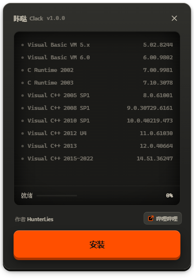

<p align="center">
  
</p>

<h1 align="center">咔哒 / Clack</h1>

<p align="center">Windows 单文件运行库合集，双击就能用，删掉就是卸载</p>

<p align="center">
  
  
</p>

<table>
<tr>
<td width="230" valign="top"></td>
<td valign="top">

补齐那些"缺了就打不开游戏"的运行库。报 `缺少 msvcr100.dll`、`缺少 msvcp140.dll`，基本就是它。

十个组件：Visual Basic VM 5.x / 6.0、C Runtime 2002 / 2003、Visual C++ 2005 SP1、2008 SP1、2010 SP1（含 KB2565063）、2012 U4、2013、2015-2022。

x86 和 x64 一起装。老游戏大多是 32 位，只装 64 位照样缺库。

全程离线运行，不驻留、不自启、不装服务。

</td>
</tr>
</table>

## 安装

从 [Releases](https://github.com/Hunter-Lies/clack/releases) 下 `Clack-1.0.0-x64.exe`，双击，过 UAC，点按钮。

## 改动

| 位置 | 内容 |
|---|---|
| `C:\ProgramData\Click\payload\<版本>\` | 解出来的运行库，60 多 MB，首次运行解一次 |
| `%TEMP%\Click.log`、`C:\ProgramData\Click\<组件>\install.log` | 日志 |
| System32 / SysWOW64 / WinSxS、「应用和功能」里的那些项 | 微软安装器写的 |

想清干净：删 exe，删 `C:\ProgramData\Click\`，装上的运行库去「应用和功能」卸。

## 问题

- **提示"已保护你的电脑"**<br>没买代码签名证书，点「更多信息」→「仍要运行」
- **要重启吗**<br>一般不用
- **装到一半关不掉窗口**<br>故意的；真卡死了用任务管理器结束后，看 `%TEMP%\Click.log` 停在哪一项
- **系统要求**<br>Windows 10 / 11 x64；界面走 WebView2，Win11 自带

## 构建

需要 Node 20+、pnpm、Rust（含 MSVC 工具链）、7-Zip。

```powershell
# 官方安装器下到 _work\download\，老运行库自备到 _work\legacy\（清单见 tools\legacy\README.md）
.\tools\stage_payload.ps1     # 整理成 _work\payload
.\make_release.ps1            # 出单文件 exe，产物在 out\

cd ui ; pnpm install ; pnpm tauri dev     # 开发调试
```

发布前自检：

```powershell
.\tools\check_deps.ps1   # exe 自己不依赖任何运行库（解析 PE 导入表）
.\tools\check_repo.ps1   # 仓库里没有本机痕迹和二进制
```

组件表在 [ui/src-tauri/src/lib.rs](ui/src-tauri/src/lib.rs)——装哪几个、什么版本、什么参数，都在那一个文件里。文件名录在 [docs/组件来源与校验.md](docs/组件来源与校验.md)，踩过的坑在 [docs/设计取舍.md](docs/设计取舍.md)。

仓库里只有源码，没有可执行文件。

## 框架

Tauri 2 + Rust 后端，WebView2 里的 Vue 3 界面，Vite 打包：Tauri `2.12.4`（MIT / Apache-2.0）、Vue `3.5.43`（MIT）、Vite `8.3.4`（MIT，仅构建期）。

这些组件按各自许可分发，不受本仓库协议约束，详见 [THIRD-PARTY.md](THIRD-PARTY.md)。

## 许可

代码用 [CC BY-NC-SA 4.0](LICENSE)：署名、非商业、相同方式共享——转载或改完再发，留署名、别拿去卖、用同样的协议。

图标取自 [Lucide](https://lucide.dev)（ISC）。程序安装的那些微软运行库版权归 Microsoft，不在本仓库里。
